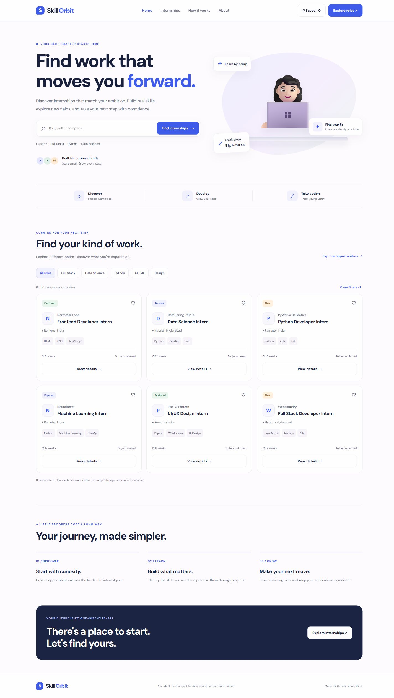
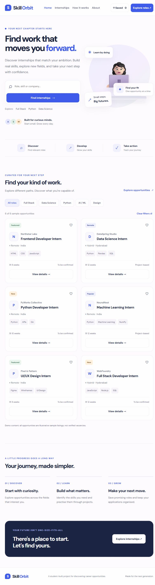
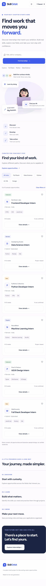

# SkillOrbit — Responsive Internship Board

A framework-free student project for discovering and bookmarking fictional internship opportunities.

**Live preview:** https://devop785.github.io/SkillOrbit/

## Features
- Six reusable internship records rendered through JavaScript.
- Live search by role, company, domain, location and skill.
- Domain filters that combine with search and saved-only results.
- Empty-results feedback with a reset action.
- Saved roles persisted using localStorage, with validation and visible error feedback when storage is unavailable or corrupt. Browsing and in-memory saving remain usable.
- Accessible native buttons, labelled search and dialog, keyboard focus indicators, skip link and reduced-motion styles.
- Responsive card layouts and a mobile navigation menu; Saved remains accessible on mobile.

## Run locally
Clone this repository and open index.html, or serve the directory:

```sh
python -m http.server 8765
```

Visit http://localhost:8765. No installation or build step is needed.

## Technology and structure
- index.html: semantic page structure, controls and details dialog.
- style.css: responsive layout and focus/feedback styles.
- script.js: sample data, rendering, combined filters and bookmark persistence.
- screenshots/: desktop, tablet and mobile previews.
- verify.cjs: dependency-free Node.js logic regression checks.

## Screenshots

### Desktop (1440px)


### Tablet (768px)


### Mobile (390px)


## Verification
Run `node verify.cjs` and `node --check script.js`.

Logic checks cover malformed JSON, invalid saved-data formats, blocked storage, stale saved IDs, search, combined filters, empty results, reset and saving. Browser layout checks at 390px, 768px and 1440px confirmed usable search fields, visible Saved controls and no horizontal page overflow. Native Enter/Escape interactions were checked during review.

Manual error-state check: use browser developer tools to set the skillorbit-saved localStorage value to invalid JSON, then reload. The cards should still render with an error notice. Saving again repairs storage if writing is available.

## Scope and limitations
All opportunities are fictional demonstration records, not verified vacancies. This is a static frontend, without accounts, a server, real applications or cross-device synchronisation. Google Fonts requires an internet connection; a sans-serif fallback is provided.

This repository covers the visible Responsive Internship Board task requirements. Separate course product briefs or seed-file contracts were not supplied and have not been independently checked.
